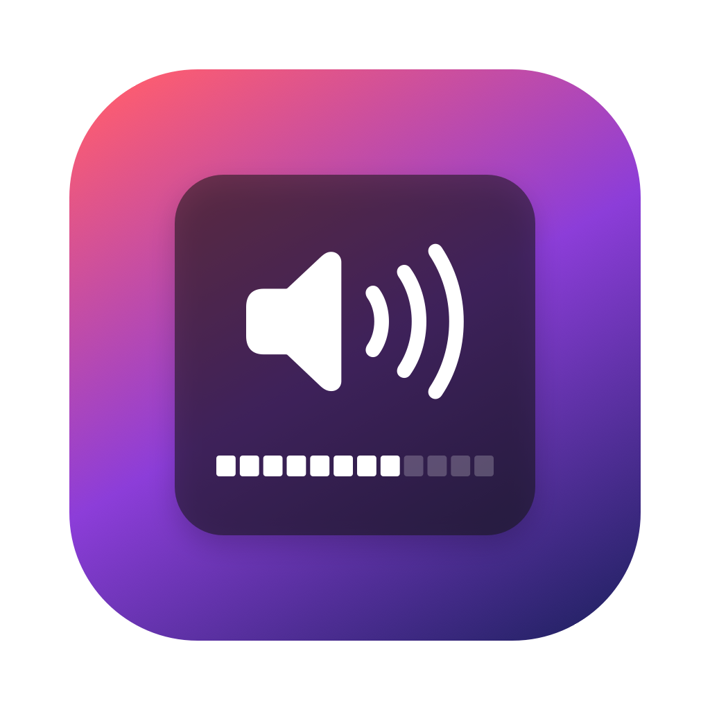

# Earshot

The old macOS volume pop-up. Big, centered and right where you're looking.

## Why

I hated the new Liquid Glass volume pop-up. It lives in the **top right corner** of the screen, and I have a **49" ultrawide**, so the top right corner is basically in another zip code. Way outside my peripheral vision. I'd hit volume up and have no idea what happened.

The old macOS one was perfect: a big rounded square in the middle near the bottom, a speaker icon, and a row of little chiclets. So I brought it back.

I 100% vibe coded this. I don't even know Swift. It works on my machine. 🤷

## What it does

- Catches **only** the volume keys (up, down, mute). Brightness and everything else pass straight through, so it plays nicely with MonitorControl, BetterDisplay and the rest.
- Changes the volume of whatever output is active.
- Shows the classic pop-up on **whichever screen your mouse is on**.
- `⇧ Shift` + `⌥ Option` + volume key = quarter steps
- `⇧ Shift` + volume key = plays the little click
- `⌥ Option` + volume key = opens Sound settings
- Starts at login by itself.

## Install

```sh
./build.sh --install
```

Then allow **Earshot** under System Settings → Privacy & Security → **Accessibility**.

It's signed ad-hoc by default. If you have a signing certificate, put its identity hash in `.sign-identity` (or set `SIGN_IDENTITY`), so the Accessibility permission survives rebuilds.

## Heads up

If you use boringNotch, turn off its **Replace system HUD** setting. It grabs the brightness keys, so tools like MonitorControl stop working.

## Icon

The icon is drawn in code. Regenerate it with `swift scripts/make-icon.swift`.
